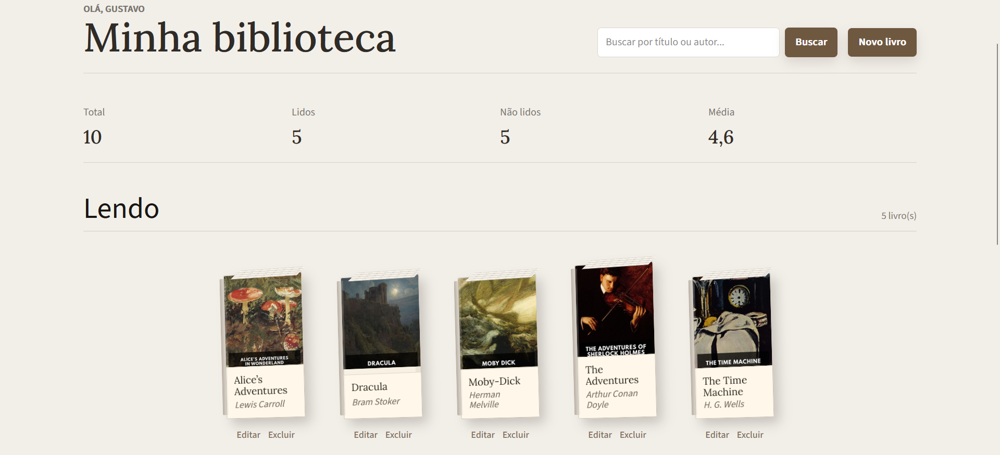

# Biblioteca Virtual

Desenvolvi uma aplicação web para organizar uma biblioteca pessoal e acompanhar leituras. Na entrega final, cada pessoa pode criar uma conta, cadastrar livros, buscar por título ou autor e consultar seu progresso de leitura.

*Captura da versão entregue com dez livros no catálogo. As capas exibidas na seção Lendo são do Standard Ebooks.*

## Interface

Usei **JSP, JSTL e CSS** para montar a estante, os formulários e as fichas dos livros. A tela inicial mostra os totais de livros lidos e não lidos, além da média das notas. O detalhe do livro apresenta informações como gênero, ano e resumo. A interface usa uma capa tipográfica quando não há uma imagem cadastrada.

## Back-end

Implementei a aplicação em **Java 21 e Spring Boot 3.5**, com Spring MVC para as rotas, sessão HTTP para o login e DAOs em **JDBC** para persistência no **PostgreSQL**. As consultas de livros e estatísticas usam o identificador do usuário autenticado. O cadastro valida os campos obrigatórios e aceita notas de 0 a 5 para livros marcados como lidos.

[Voltar ao portfólio](../README.md)
