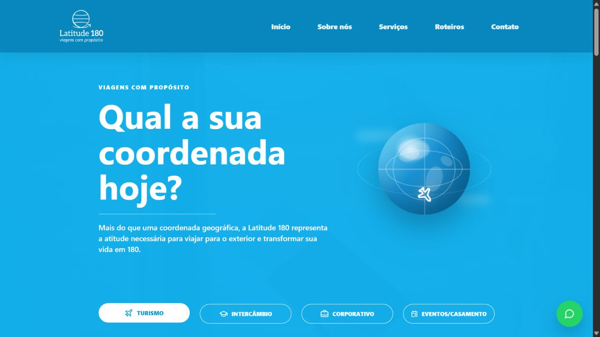

# Latitude 180

Desenvolvi uma proposta de repaginação em **React e Vite** para o site da agência de viagens Latitude 180. Organizei as modalidades de viagem na página inicial para que o visitante possa explorar serviços e roteiros antes de entrar em contato.

*Captura da repaginação executada localmente.*

## O que implementei

- **Seleção de serviços.** Ao escolher turismo, intercâmbio, corporativo ou eventos e casamentos, o painel abaixo da abertura muda para mostrar os detalhes da modalidade.
- **Navegação responsiva.** O menu leva às seções da página, e os cartões de roteiro apresentam destinos, experiências e um caminho para o contato.
- **Formulário de viagem.** A interface monta uma mensagem com os dados preenchidos e a abre no e-mail ou no WhatsApp escolhido pelo visitante.

A repaginação foi descontinuada por decisão do cliente. [Site original da agência](https://www.latitude180.com.br/)

[Voltar ao portfólio](../README.md)
