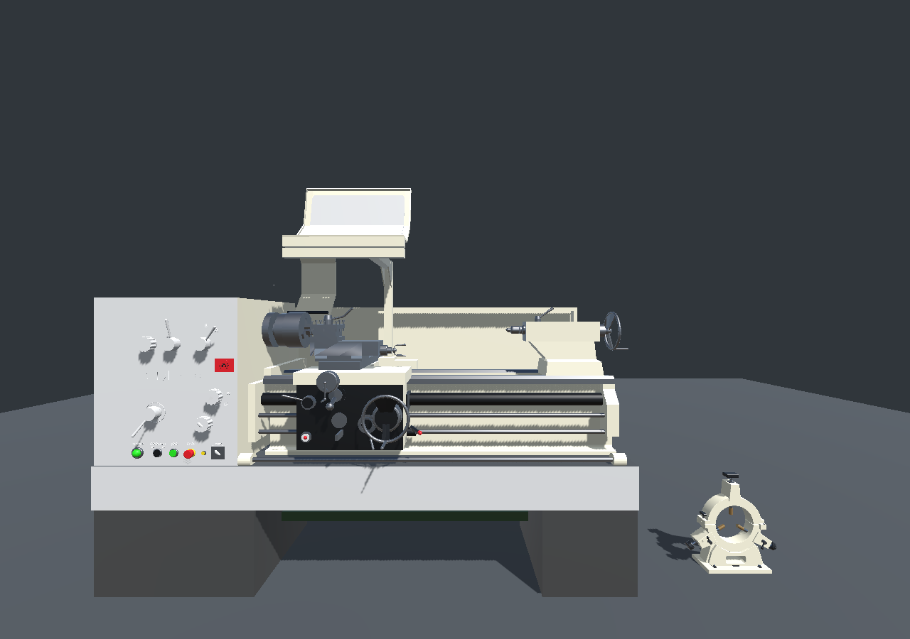

# Torno mecânico CDL-400 em realidade virtual

**CTISM/UFSM · Bolsa de ensino · Blender, Unity, C#, OpenXR e Meta Quest 2**

O projeto explora como a realidade virtual pode apoiar o ensino de segurança industrial. O torno CDL-400 do laboratório do CTISM serviu de referência para criar um ambiente em que estudantes possam reconhecer componentes e áreas de risco e se familiarizar com equipamentos de proteção.

*Captura da etapa de visualização na Unity.*

## Minha contribuição

Modelei componentes do torno no Blender, participei da integração do modelo à Unity e dos testes da experiência no Meta Quest 2. O trabalho foi selecionado para apresentação oral na 41ª Jornada Acadêmica Integrada da UFSM.

## Desenvolvimento

1. **Modelagem.** Usei o equipamento do laboratório como referência para a representação do torno e de seus componentes. Na passagem do Blender para a Unity, o modelo foi exportado em FBX.
2. **Visualização no Quest 2.** A primeira entrega foi uma build Android dedicada à visualização do torno. A cena usou XR Origin e OpenXR para configurar a visualização no headset. O projeto registra um teste de visualização no dispositivo.
3. **Protótipo interativo.** A versão seguinte da cena passou a incluir um tutorial, controles rastreados e clipes de animação. Investigamos por que o analógico esquerdo deixava de responder e por que as mãos virtuais atravessavam componentes. O ajuste de locomoção envolveu habilitar as ações de entrada do XR Interaction Toolkit na cena. O diagnóstico de colisão identificou peças configuradas como gatilhos, que detectam sobreposição e permitem que as mãos as atravessem.
4. **Próxima etapa.** O roteiro de animações de usinagem aguarda validação técnica. A avaliação educacional prevista inclui identificação de riscos, erros, tempo de execução e cumprimento de procedimentos.

[Voltar ao portfólio](../README.md)
